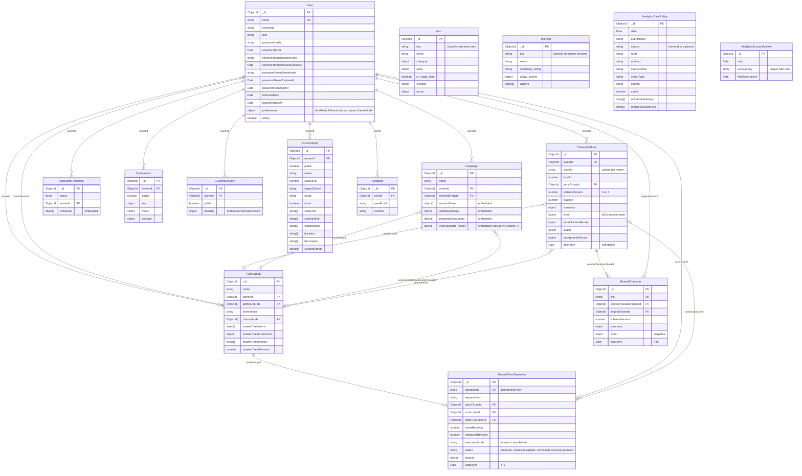

# Arcane Ledger: MongoDB collections

Source: `server/src/models/*.ts` (Mongoose). MongoDB has no real foreign keys; lines below are `ObjectId` references (`ref:` in the schemas). Attribute lists are the main fields, not every field.

## Notes

- `Item`, `Monster`, `AnalyticsDailyRollup` and `AnalyticsAccountActivity` have no references to other collections.
- `PartyGroup.characterIds` and `CharacterSheet.partyGroupId` describe the same membership from both sides.
- `SharedCharacter` and `MasterChestOperation` expire automatically (MongoDB TTL index on `expiresAt`).
- `CharacterSheet` is unique on `(ownerId, clientId)`; `User.email` is unique.
- Embedded sub-documents (Campaign notes/encounters, EncounterTemplate creatures, User preferences) are not separate collections.
